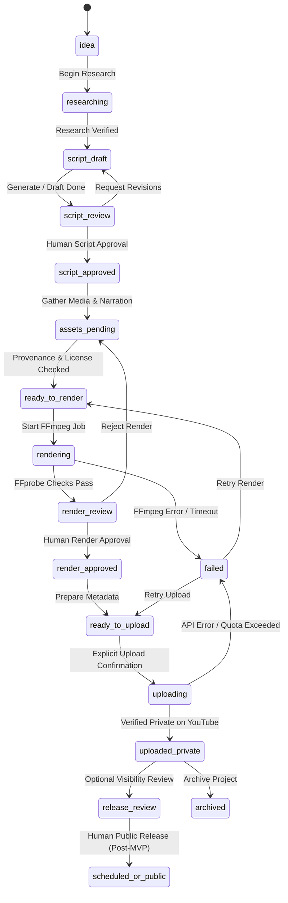

# YouTube Automation Studio — System Architecture

> **Specification Reference:** `youtube-automation-studio-master-prompt.md`  
> **Status:** Phase 0 Baseline Design  
> **Target OS:** Windows 10/11 Development & Ubuntu Linux Deployment

---

## 1. System Overview & Monorepo Structure

YouTube Automation Studio is structured as a lightweight monorepo containing a NestJS backend API, a React + Vite frontend dashboard, and persistent local media storage.

```text
youtube-automation/
├── apps/
│   ├── api/                          # NestJS 10.x backend service
│   │   ├── src/
│   │   │   ├── common/               # Filters, interceptors, guards, encryption
│   │   │   ├── config/               # Joi/class-validator env schema
│   │   │   ├── database/             # TypeORM data-source, migrations, entities
│   │   │   └── modules/              # Domain modules (see section 2)
│   │   ├── test/                     # Unit and e2e tests
│   │   ├── tsconfig.json
│   │   └── package.json
│   │
│   └── web/                          # React 18 / Vite 6 creator dashboard
│       ├── src/
│       │   ├── api/                  # Typed API clients & react-query hooks
│       │   ├── components/           # Reusable UI components & layouts
│       │   ├── pages/                # Dashboard, Ideas, Projects, Render, Upload
│       │   └── styles/               # Design tokens, variables, typography
│       ├── vite.config.ts
│       └── package.json
│
├── storage/                          # Local disk asset storage (Git-ignored)
│   ├── projects/                     # Per-project intermediate files
│   ├── assets/                       # Raw user/licensed media assets
│   ├── narration/                    # Generated/imported audio voice tracks
│   ├── renders/                      # Final rendered MP4 output files
│   └── thumbnails/                   # Thumbnail images
│
├── docs/                             # Technical guides & deployment documentation
├── .env.example                      # Safe environment variable template
├── .gitignore                        # Protection against leaking secrets & media
├── PLAN.md                           # Master implementation roadmap
├── ARCHITECTURE.md                   # This document
├── IMPLEMENTATION_STATUS.md          # Real-time phase tracking
└── README.md                         # Quick start guide
```

---

## 2. Backend Modular Decomposition (NestJS)

The backend is decomposed into cohesive domain modules with strict encapsulation:

| Module | Core Responsibility |
| :--- | :--- |
| `HealthModule` | Liveness/readiness probes (`/api/health`), checking DB connection and storage write permissions. |
| `SettingsModule` | Configuration status probe (`/api/settings/status`), reporting mock/configured flags without leaking secrets. |
| `ChannelsModule` | Management of YouTube channel profiles, default niches, and language preferences. |
| `TopicsModule` | Idea capture, priority scoring, backlog organization, and conversion to video projects. |
| `ResearchModule` | Factual sources collection, citations, claim verification flags, and publisher records. |
| `AiProvidersModule` | Provider interfaces and factory for LLM/text generation (Mock, OpenAI, Anthropic). |
| `ScriptsModule` | Script drafting, versioned scene breakdown, diff viewing, and human approval gates. |
| `AssetsModule` | Asset ingestion, SHA-256 checksums, license classification, and provenance enforcement. |
| `NarrationModule` | Text-to-speech synthesis (Mock, ElevenLabs) and external voiceover audio import. |
| `RenderingModule` | FFmpeg command construction, timeline composition, FFprobe validation, and review preview. |
| `ThumbnailsModule` | Generation or import of video thumbnails and aspect-ratio validation. |
| `VideosModule` | High-level video project orchestrator and lifecycle state machine controller. |
| `YouTubeModule` | Google OAuth 2.0 PKCE/state flow, AES-256 token encryption, and private-only upload execution. |
| `ApprovalsModule` | Immutable audit records for explicit human decisions (script, render, upload). |
| `JobsModule` | Database-backed background queue with lease locking, exponential backoff, and idempotency. |
| `AnalyticsModule` | Read-only YouTube Data API channel & video performance statistics. |
| `AuditModule` | Immutable system event logging for security-sensitive state transitions. |

---

## 3. Provider Abstractions & Factory Pattern

To guarantee local operation without recurring API costs, all external AI and cloud services are hidden behind TypeScript interfaces:

```text
               ┌───────────────────────────────┐
               │    TextGenerationProvider     │
               └──────────────┬────────────────┘
                              │
         ┌────────────────────┼────────────────────┐
         │                    │                    │
┌────────┴────────┐  ┌────────┴────────┐  ┌────────┴────────┐
│ MockTextProvider│  │OpenAiTextProvider│ │AnthropicProvider│
└─────────────────┘  └─────────────────┘  └─────────────────┘
```

### Provider Interfaces
```typescript
export interface TextGenerationProvider {
  generateScript(input: ScriptPromptDto): Promise<ScriptResultDto>;
  generateScenePlan(input: ScriptDto): Promise<ScenePlanDto>;
  generateMetadata(input: ScriptDto): Promise<VideoMetadataDto>;
}

export interface TextToSpeechProvider {
  synthesize(text: string, options: TtsVoiceOptions): Promise<SynthesizedAudioResult>;
}

export interface VideoRenderer {
  render(project: VideoProject, outputPath: string): Promise<RenderOutputResult>;
  validate(filePath: string): Promise<MediaProbeResult>;
}

export interface YouTubePublisher {
  uploadPrivate(videoPath: string, metadata: YouTubeUploadMetadata): Promise<YouTubeUploadResult>;
  updateMetadata(videoId: string, metadata: YouTubeUploadMetadata): Promise<void>;
  getChannelStatus(channelId: string): Promise<ConnectedChannelStatus>;
}
```

- Each provider has a corresponding `Mock` implementation active when `TEXT_PROVIDER=mock`, `TTS_PROVIDER=mock`, or credentials are absent.
- Real provider invocation is guarded by the `ENABLE_EXTERNAL_API_CALLS` boolean switch.

---

## 4. Video Project Lifecycle State Machine

The project state machine enforces strict human approval gates at every critical transition. Under no circumstances can a step be bypassed:



### Safety Rules Enforced by State Machine:
1. **Script Approval Barrier:** A project cannot enter `ready_to_render` without an approved script record (`approval_records`).
2. **Provenance Barrier:** All media assets attached to the project must have `license_type` declared and `commercial_use_allowed === true` (or explicit user justification).
3. **FFprobe Quality Gate:** Before moving to `render_review`, FFprobe verifies video container, minimum resolution (1080p or 720p), H.264/AAC codecs, and non-zero duration.
4. **Human Upload Gate:** Uploads require explicit human button click and confirmation checkbox. Uploads default to `privacyStatus: 'private'`.

---

## 5. Database Architecture & Schema Design

Database: **MySQL 8.x**  
ORM: **TypeORM** (configured with explicit migration files; auto-synchronize disabled).

```text
┌────────────────────┐       1:N       ┌─────────────────────┐
│  channel_profiles  ├─────────────────┤    video_projects   │
└────────────────────┘                 └──────────┬──────────┘
                                                  │ 1:N
             ┌───────────────────┬────────────────┼───────────────────┬───────────────────┐
             │ 1:N               │ 1:N            │ 1:N               │ 1:N               │ 1:N
     ┌───────┴────────┐  ┌───────┴──────┐ ┌───────┴────────┐  ┌───────┴──────┐  ┌─────────┴────────┐
     │research_sources│  │   scripts    │ │     assets     │  │  narrations  │  │   render_jobs    │
     └────────────────┘  └──────────────┘ └────────────────┘  └──────────────┘  └──────────────────┘
                                                  │ 1:N
             ┌────────────────────────────────────┼───────────────────────────────────┐
             │ 1:N                                │ 1:N                               │ 1:N
     ┌───────┴────────┐                   ┌───────┴────────┐                  ┌───────┴────────┐
     │approval_records│                   │youtube_uploads │                  │  audit_events  │
     └────────────────┘                   └────────────────┘                  └────────────────┘
```

### Core Schema Definition:

1. **`channel_profiles`**
   - `id`: UUID (PK)
   - `name`: VARCHAR(255)
   - `niche`: VARCHAR(100)
   - `target_regions`: JSON array (e.g. `["US", "GB"]`)
   - `language`: VARCHAR(10) default `'en'`
   - `youtube_channel_id`: VARCHAR(100) nullable
   - `encrypted_oauth_tokens`: TEXT nullable (AES-256-GCM ciphertext)
   - `created_at`, `updated_at`: TIMESTAMP

2. **`video_projects`**
   - `id`: UUID (PK)
   - `channel_profile_id`: UUID (FK)
   - `title`: VARCHAR(255)
   - `working_title`: VARCHAR(255)
   - `topic`: TEXT
   - `target_audience`: VARCHAR(255)
   - `format`: ENUM (`'long_form'`, `'short'`)
   - `target_duration_seconds`: INT
   - `status`: ENUM (17 lifecycle states)
   - `active_script_id`: UUID nullable
   - `created_at`, `updated_at`: TIMESTAMP

3. **`research_sources`**
   - `id`: UUID (PK)
   - `video_project_id`: UUID (FK)
   - `url`: TEXT
   - `title`: VARCHAR(255)
   - `publisher`: VARCHAR(255)
   - `published_at`: TIMESTAMP nullable
   - `accessed_at`: TIMESTAMP
   - `notes`: TEXT
   - `claim_supported`: TEXT
   - `verification_status`: ENUM (`'verified'`, `'unverified'`, `'disputed'`)

4. **`scripts`**
   - `id`: UUID (PK)
   - `video_project_id`: UUID (FK)
   - `version`: INT
   - `content`: LONGTEXT
   - `outline_json`: JSON
   - `scene_plan_json`: JSON
   - `metadata_json`: JSON
   - `provider`: VARCHAR(50)
   - `model`: VARCHAR(100)
   - `status`: ENUM (`'draft'`, `'approved'`, `'superseded'`)
   - `created_at`: TIMESTAMP

5. **`assets`**
   - `id`: UUID (PK)
   - `video_project_id`: UUID (FK)
   - `asset_type`: ENUM (`'screen_recording'`, `'image'`, `'video'`, `'audio'`, `'music'`, `'graphic'`, `'other'`)
   - `storage_path`: VARCHAR(500)
   - `original_filename`: VARCHAR(255)
   - `mime_type`: VARCHAR(100)
   - `checksum_sha256`: CHAR(64)
   - `source_url`: TEXT nullable
   - `creator`: VARCHAR(255) nullable
   - `license_type`: ENUM (`'public_domain'`, `'creative_commons'`, `'purchased_license'`, `'user_created'`, `'fair_use_quoted'`)
   - `license_notes`: TEXT
   - `attribution_text`: TEXT nullable
   - `commercial_use_allowed`: BOOLEAN
   - `created_at`: TIMESTAMP

6. **`narrations`**
   - `id`: UUID (PK)
   - `video_project_id`: UUID (FK)
   - `script_id`: UUID (FK)
   - `provider`: VARCHAR(50)
   - `voice_id`: VARCHAR(100)
   - `storage_path`: VARCHAR(500)
   - `duration_seconds`: DECIMAL(8,2)
   - `status`: ENUM (`'pending'`, `'ready'`, `'failed'`)
   - `created_at`: TIMESTAMP

7. **`render_jobs`**
   - `id`: UUID (PK)
   - `video_project_id`: UUID (FK)
   - `status`: ENUM (`'queued'`, `'rendering'`, `'completed'`, `'failed'`, `'cancelled'`)
   - `output_path`: VARCHAR(500) nullable
   - `thumbnail_path`: VARCHAR(500) nullable
   - `ffmpeg_command_summary`: TEXT (secret-redacted)
   - `started_at`, `finished_at`: TIMESTAMP nullable
   - `error_code`, `error_message`: TEXT nullable
   - `created_at`: TIMESTAMP

8. **`approval_records`**
   - `id`: UUID (PK)
   - `video_project_id`: UUID (FK)
   - `approval_type`: ENUM (`'script'`, `'assets'`, `'render'`, `'upload'`, `'public_release'`)
   - `decision`: ENUM (`'approved'`, `'rejected'`)
   - `notes`: TEXT nullable
   - `approved_by`: VARCHAR(100) default `'local_user'`
   - `created_at`: TIMESTAMP

9. **`youtube_uploads`**
   - `id`: UUID (PK)
   - `video_project_id`: UUID (FK)
   - `youtube_video_id`: VARCHAR(50) nullable
   - `privacy_status`: ENUM (`'private'`) default `'private'`
   - `upload_status`: ENUM (`'pending'`, `'uploading'`, `'completed'`, `'failed'`)
   - `title`: VARCHAR(100)
   - `description`: TEXT
   - `tags_json`: JSON
   - `category_id`: VARCHAR(10)
   - `made_for_kids`: BOOLEAN default false
   - `contains_synthetic_media`: BOOLEAN default false
   - `published_at`: TIMESTAMP nullable
   - `last_error_code`, `last_error_message`: TEXT nullable
   - `created_at`, `updated_at`: TIMESTAMP

10. **`jobs` (Job Runner)**
    - `id`: UUID (PK)
    - `job_type`: VARCHAR(100)
    - `reference_id`: UUID
    - `status`: ENUM (`'pending'`, `'running'`, `'completed'`, `'failed'`)
    - `attempt_count`: INT default 0
    - `max_attempts`: INT default 3
    - `scheduled_at`: TIMESTAMP
    - `started_at`, `finished_at`: TIMESTAMP nullable
    - `locked_at`: TIMESTAMP nullable
    - `error_message`: TEXT nullable
    - `created_at`, `updated_at`: TIMESTAMP

11. **`audit_events`**
    - `id`: UUID (PK)
    - `actor`: VARCHAR(100)
    - `action`: VARCHAR(100)
    - `entity_type`: VARCHAR(100)
    - `entity_id`: UUID
    - `details_json`: JSON
    - `created_at`: TIMESTAMP

---

## 6. FFmpeg Video Rendering Engine

The rendering engine converts the approved script, scene plan, media assets, and narration audio into a finished MP4 container.

### Execution Safeguards:
1. **Child Process Spawn:** Executes via `child_process.spawn(ffmpegPath, argsArray, { windowsHide: true })` — NEVER shell execution via string concatenation (`exec`), completely eliminating command injection vectors.
2. **Path Sanitization:** File paths are validated against allowed root directories and resolved with `path.resolve` to prevent directory traversal.
3. **Progress Streaming:** `stderr` output from FFmpeg is parsed using regular expressions to calculate render completion percentage (emitted over WebSockets/SSE to the UI) without buffering massive logs in memory.
4. **Validation with FFprobe:** The completed file is inspected with `ffprobe -v error -show_entries stream=codec_name,width,height,duration -show_entries format=size -of json <output_path>`.

---

## 7. Security Architecture & YouTube OAuth Integration

### 1. Token Encryption at Rest
- Sensitive tokens (Google OAuth `access_token`, `refresh_token`, and provider API keys if stored in DB) are encrypted using **AES-256-GCM**.
- Key derived from `YOUTUBE_TOKEN_ENCRYPTION_KEY` (32 bytes hex).
- Each encryption operation generates a unique 12-byte initialization vector (IV) and a 16-byte authentication tag.
- Stored as `iv:authTag:ciphertext`.

### 2. OAuth 2.0 Security
- State parameters are generated using `crypto.randomBytes(32).toString('hex')` and cached in session/database with a 10-minute expiry to prevent CSRF login attacks.
- Scopes strictly limited to `https://www.googleapis.com/auth/youtube.upload` and `https://www.googleapis.com/auth/youtube.readonly`.
- Tokens are never exposed in REST API responses or logs.

### 3. Log Redaction Interceptor
- A NestJS global interceptor strips Authorization headers, API keys, client secrets, and token payloads before logging requests or errors.

---

## 8. Windows Development to Ubuntu Linux Deployment Path

| Dimension | Windows 10/11 Local (Current) | Ubuntu Linux (Future Deployment) |
| :--- | :--- | :--- |
| **Node.js** | Node.js v22.12.0 (Installed) | Node.js 22 LTS via NodeSource |
| **MySQL** | WampServer MySQL 8.0.40 (Port 3306) | MySQL 8.0 Server or Docker Compose |
| **FFmpeg** | `C:\WINDOWS\system32\ffmpeg.exe` | `/usr/bin/ffmpeg` via `apt install ffmpeg` |
| **Process Manager** | Local terminal (`npm run start:dev`) | PM2 cluster mode or systemd service |
| **Reverse Proxy** | Vite dev server proxy (`/api` -> 3000) | Nginx with SSL termination (Let's Encrypt) |
| **Path Handling** | Normalized via Node.js `path` module | Normalized via Node.js `path` module |
